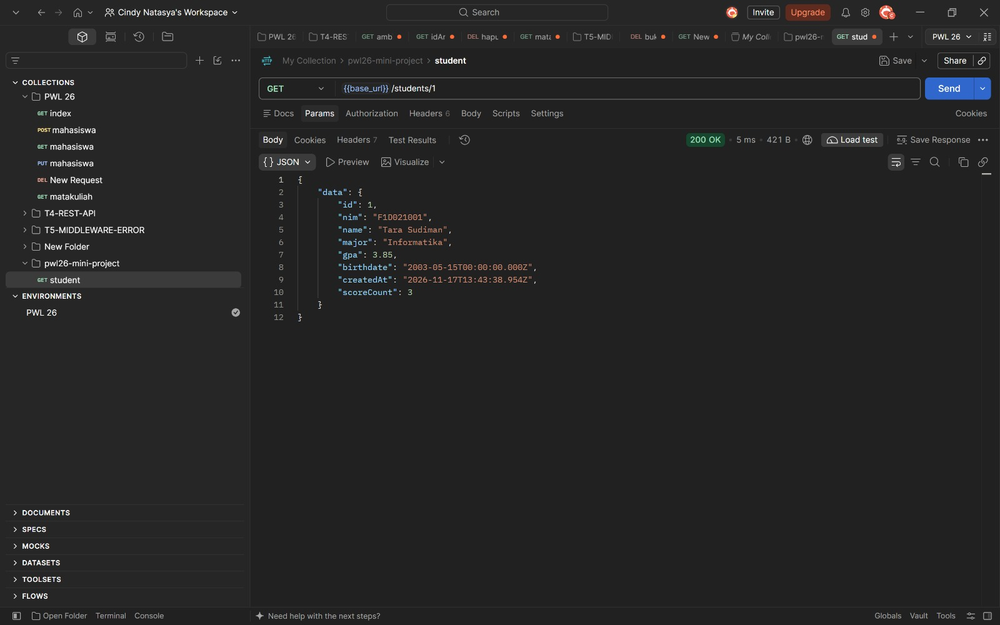
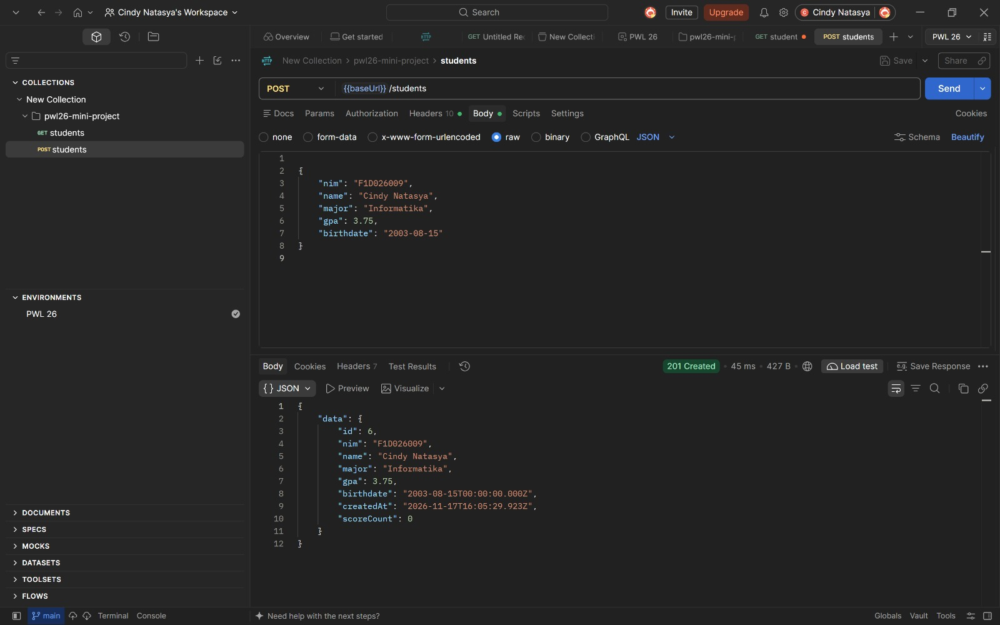
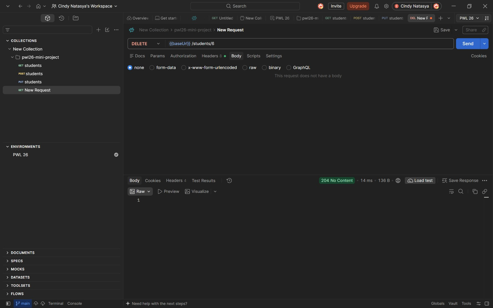
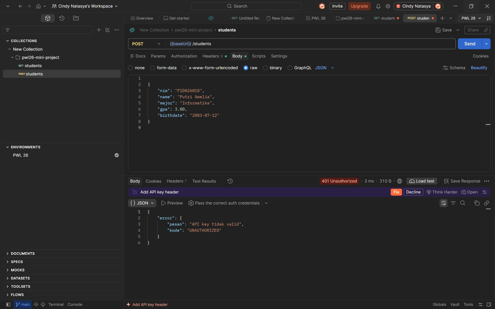
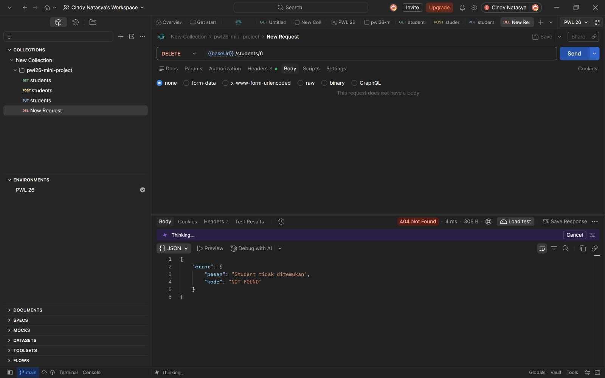
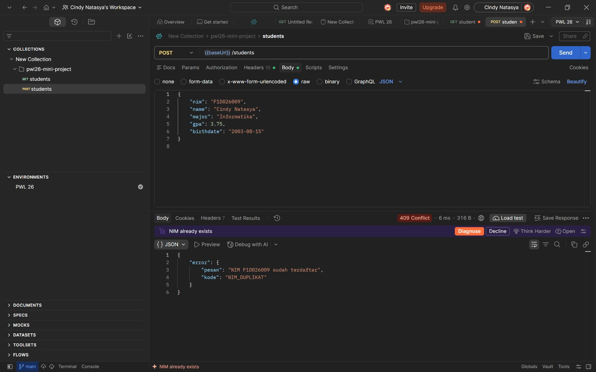
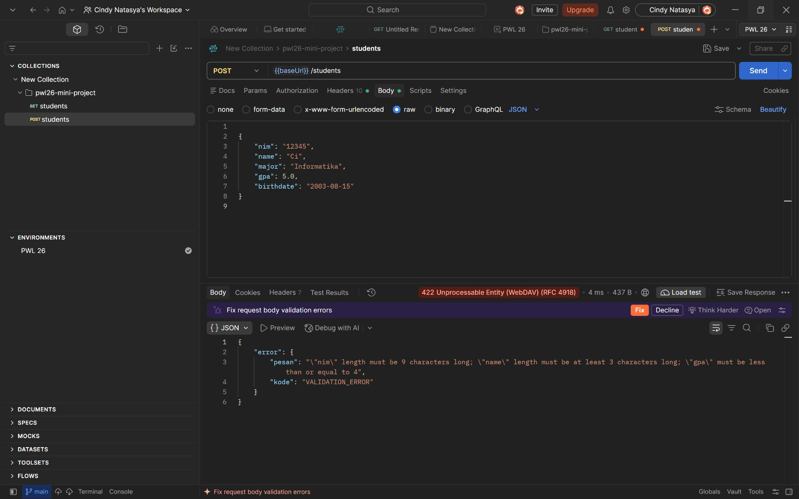
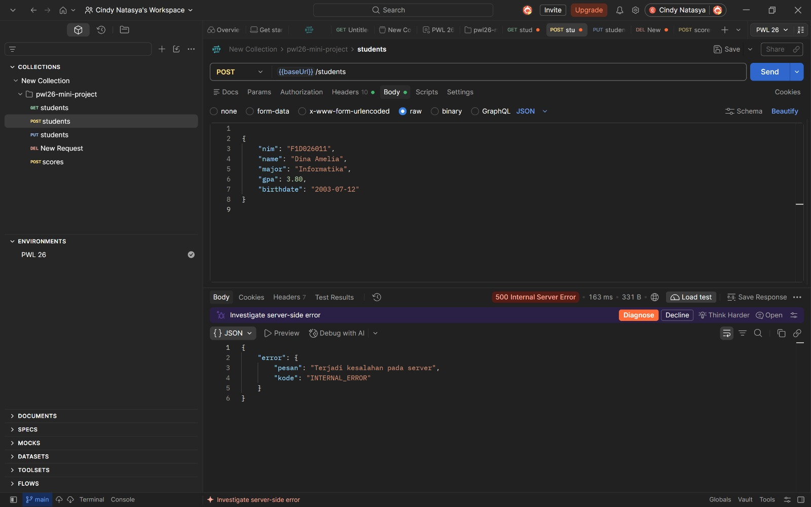

# ETS — Mini Project REST API (Express.js + MySQL)

## Identitas

- **Nama:** Cindy Natasya Aulia Putri
- **NIM:** [F1D202310109]
- **Project:** pwl26-mini-project
- **Varian:** Students API

## YouTube

[Masukkan link video live coding DELETE]

## Cara Menjalankan

1. Jalankan `npm install` untuk mengunduh seluruh dependensi project.

2. Buat database MySQL dengan nama `students_api`.

3. Salin file `.env.example` menjadi `.env`, kemudian sesuaikan konfigurasi `DATABASE_URL` dan `PORT=3000` dengan pengaturan MySQL lokal.

4. Jalankan migrasi database menggunakan `npx prisma migrate deploy`.

5. Generate Prisma Client menggunakan `npx prisma generate`.

6. Jalankan server menggunakan `node --watch index.js`.

7. Lakukan pengujian endpoint menggunakan Postman atau REST Client dengan alamat `http://localhost:3000`.

Endpoint POST, PUT, dan DELETE memerlukan header `x-api-key` dengan nilai `rahasia123`.

## Struktur Proyek

```text
pwl26-mini-project/
├── generated/
│   └── prisma/                   
├── prisma/
│   ├── migrations/               
│   └── schema.prisma              
├── screenshots/                    
│   ├── 200.jpeg
│   ├── 201.jpeg
│   ├── 204.jpeg
│   ├── 401.jpeg
│   ├── 404.jpeg
│   ├── 409.jpeg
│   ├── 422.jpeg
│   ├── 500.jpeg
├── src/
│   ├── controllers/
│   │   ├── student.controller.js  # Menangani request dan response Student
│   │   └── score.controller.js    # Menangani request dan response Score
│   ├── data/
│   │   ├── student.data.js        # Query Prisma pada tabel Student
│   │   └── score.data.js          # Query Prisma pada tabel Score
│   ├── lib/
│   │   └── prisma.js              # Konfigurasi Prisma Client dan adapter MariaDB
│   ├── middleware/
│   │   ├── cekApiKey.js           # Memvalidasi header x-api-key
│   │   ├── errorHandler.js        # Menangani error secara terpusat
│   │   ├── logger.js              # Mencatat request HTTP dan durasinya
│   │   ├── notFound.js            # Menangani endpoint yang tidak tersedia
│   │   └── validasi.js            # Memvalidasi request menggunakan Joi
│   ├── routes/
│   │   ├── student.routes.js      # Mendefinisikan endpoint Student
│   │   └── score.routes.js        # Mendefinisikan endpoint Score
│   ├── services/
│   │   ├── student.service.js     # Logika bisnis pengelolaan Student
│   │   └── score.service.js       # Logika bisnis Score dan transaksi database
│   ├── utils/
│   │   └── AppError.js            # Custom error dengan status dan kode
│   └── validators/
│       ├── student.validator.js   # Aturan Joi untuk Student
│       └── score.validator.js     # Aturan Joi untuk Score
├── .env.example                   # Contoh konfigurasi environment
├── .gitignore                     # Daftar file yang diabaikan Git
├── index.js                       # Entry point Express
├── package.json                   # Dependensi dan konfigurasi project
├── prisma.config.js               # Konfigurasi Prisma
├── requests.http                  # Request pengujian REST Client
└── README.md                      # Dokumentasi project
```

## Endpoint

| Method | URL | Middleware | Status |
|---|---|---|---|
| `GET` | `/students` | logger | 200 OK / 400 |
| `GET` | `/students?major=Informatika` | logger | 200 OK |
| `GET` | `/students?halaman=1&ukuran=2` | logger | 200 OK / 400 |
| `GET` | `/students/:id` | logger | 200 OK / 400 / 404 |
| `GET` | `/students/:id/scores` | logger | 200 OK / 400 / 404 |
| `POST` | `/students` | logger, cekApiKey, validasi | 201 / 401 / 409 / 422 |
| `PUT` | `/students/:id` | logger, cekApiKey, validasi | 200 / 400 / 401 / 404 / 409 / 422 |
| `DELETE` | `/students/:id` | logger, cekApiKey | 204 / 400 / 401 / 404 |
| `GET` | `/scores` | logger | 200 OK |
| `POST` | `/scores` | logger, cekApiKey, validasi | 201 / 401 / 404 / 422 |
| `DELETE` | `/scores/:id` | logger, cekApiKey | 204 / 400 / 401 / 404 |

Selain status yang tercantum, endpoint juga dapat menghasilkan 500 apabila terjadi kesalahan internal server.

## Uji Endpoint

Pengujian dilakukan menggunakan Postman untuk memastikan seluruh endpoint memberikan status HTTP dan response sesuai skenario yang dijalankan.

### Pengujian 200 OK

Pengujian endpoint `GET /students`, `GET /students/:id`, `GET /students/:id/scores`, `GET /scores`, dan `PUT /students/:id` untuk memastikan proses pengambilan serta perubahan data berhasil.



### Pengujian 201 Created

Pengujian endpoint `POST /students` dan `POST /scores` untuk memastikan data mahasiswa maupun nilai mata kuliah berhasil ditambahkan ke database.



### Pengujian 204 No Content

Pengujian endpoint `DELETE /students/:id` dan `DELETE /scores/:id` untuk memastikan data berhasil dihapus dan server mengembalikan response tanpa body.




### Pengujian 401 Unauthorized

Pengujian endpoint POST, PUT, atau DELETE dengan API Key yang salah atau tidak diberikan. Middleware `cekApiKey` menolak request dengan kode `UNAUTHORIZED`.



### Pengujian 404 Not Found

Pengujian dilakukan dengan mengakses ID Student atau Score yang tidak ditemukan, serta endpoint yang tidak terdaftar. API menghasilkan status 404 dengan kode `NOT_FOUND` atau `ROUTE_NOT_FOUND`.



### Pengujian 409 Conflict

Pengujian dilakukan dengan menambahkan Student menggunakan NIM yang sudah terdaftar. Service menolak data duplikat dan menghasilkan kode `NIM_DUPLIKAT`.



### Pengujian 422 Unprocessable Entity

Pengujian dilakukan dengan mengirimkan data yang melanggar aturan Joi, seperti NIM tidak berjumlah sembilan karakter, nama terlalu pendek, atau GPA melebihi 4. API menghasilkan kode `VALIDATION_ERROR`.



### Pengujian 500 Internal Server Error

Pengujian dilakukan dengan sengaja mengubah pemanggilan fungsi penyimpanan data menjadi fungsi yang tidak tersedia. Error ditangani oleh middleware `errorHandler`, sehingga Postman menerima pesan umum, sedangkan detail kesalahan ditampilkan pada terminal server.




## Aturan Validasi, Aturan Bisnis, dan Kode Error

### Aturan Validasi (Joi)

**Student (`skemaStudent`)**

- `nim`: string, tepat 9 karakter, wajib diisi.
- `name`: string, 3–100 karakter, wajib diisi.
- `major`: string, 3–100 karakter, wajib diisi.
- `gpa`: angka antara 0–4, opsional dengan default 0.
- `birthdate`: tanggal dengan format ISO, wajib diisi.

**Score (`skemaScore`)**

- `studentId`: bilangan bulat positif, wajib diisi.
- `course`: string, 3–100 karakter, wajib diisi.
- `score`: angka antara 0–100, wajib diisi.

### Aturan Bisnis

**1. Duplikasi NIM (Status 409)**

Setiap Student harus memiliki NIM yang unik. Ketika pengguna menambahkan atau mengubah data menggunakan NIM yang sudah digunakan mahasiswa lain, service menghasilkan kode error `NIM_DUPLIKAT`.

Pengecekan duplikasi dilakukan pada service karena memerlukan pemeriksaan terhadap data yang sudah tersimpan di MySQL.

**2. Validasi ID (Status 400)**

Parameter `id` yang diterima melalui URL harus dikonversi menjadi bilangan bulat sebelum digunakan pada query Prisma. Jika ID tidak valid, API menghasilkan error `ID_TIDAK_VALID`.

**3. Relasi Student dan Score (Status 404)**

Setiap data Score harus memiliki Student yang terdaftar. Saat menambahkan nilai, service memeriksa keberadaan Student menggunakan `studentId`.

Jika Student tidak ditemukan, API menghasilkan status 404 dengan kode `NOT_FOUND`.

**4. Transaksi Penambahan Score**

Penambahan Score menggunakan `prisma.$transaction` untuk menjalankan dua operasi sekaligus:

- Menambahkan nilai mata kuliah ke tabel Score.
- Meningkatkan `scoreCount` pada tabel Student sebanyak satu.

Kedua operasi harus berhasil bersama. Apabila salah satu gagal, Prisma membatalkan perubahan dalam transaksi.

**5. Transaksi Penghapusan Score**

Penghapusan Score juga menggunakan `prisma.$transaction` untuk menjalankan dua operasi:

- Menghapus satu data nilai dari tabel Score.
- Mengurangi `scoreCount` pada Student yang bersangkutan sebanyak satu.

Dengan demikian, jumlah nilai yang tercatat pada Student tetap sesuai dengan data Score yang dikelola melalui API.

**6. Alasan Aturan Bisnis Berada pada Service**

Joi digunakan untuk memvalidasi struktur dan nilai input, sedangkan aturan seperti pengecekan NIM duplikat, keberadaan Student, dan pelaksanaan transaksi membutuhkan pemeriksaan kondisi database.

Oleh karena itu, aturan tersebut ditempatkan pada service dan menggunakan data layer untuk mengakses MySQL melalui Prisma.

### Daftar Kode Error

| Kode Error | Status | Keterangan |
|---|---|---|
| `PAGINATION_INVALID` | 400 | Parameter halaman atau ukuran tidak valid |
| `ID_TIDAK_VALID` | 400 | ID tidak memenuhi ketentuan |
| `UNAUTHORIZED` | 401 | API Key salah atau tidak tersedia |
| `NOT_FOUND` | 404 | Student atau Score tidak ditemukan |
| `ROUTE_NOT_FOUND` | 404 | Endpoint tidak terdaftar |
| `NIM_DUPLIKAT` | 409 | NIM sudah digunakan |
| `VALIDATION_ERROR` | 422 | Input tidak memenuhi aturan Joi |
| `INTERNAL_ERROR` | 500 | Kesalahan internal server |

## Deklarasi Penggunaan AI

Dalam pengerjaan project ini, saya menggunakan ChatGPT sebagai alat bantu pada penggunaan Prisma ORM, implementasi transaksi database, penyusunan dokumentasi, dan perancangan skenario pengujian.

| Bagian | Alat AI | Dipakai untuk Apa | Cara Saya Memeriksa Hasilnya |
|---|---|---|---|
| Prisma ORM | ChatGPT | Membantu memahami konfigurasi Prisma, operasi CRUD, migrasi, dan relasi antara tabel Student dengan Score. | Menjalankan migration, memeriksa struktur tabel MySQL, serta menguji pengambilan dan penyimpanan data. |
| Transaksi Database | ChatGPT | Membantu menerapkan `prisma.$transaction` pada proses penambahan dan penghapusan Score sekaligus memperbarui `scoreCount`. | Menguji POST dan DELETE Score menggunakan Postman, lalu membandingkan perubahan pada kedua tabel MySQL. |
| Dokumentasi | ChatGPT | Membantu menyusun README, menjelaskan struktur proyek, endpoint, aturan bisnis, serta kendala dan solusi. | Mencocokkan isi dokumentasi dengan kode program dan hasil implementasi. |
| Skenario Pengujian | ChatGPT | Membantu menyusun skenario pengujian endpoint, validasi, autentikasi, transaksi, dan error handling. | Menjalankan pengujian melalui Postman dan memeriksa status HTTP, response JSON, serta log terminal. |

**Contoh prompt:**

"Bagaimana cara menggunakan Prisma `$transaction` untuk menambahkan Score sekaligus memperbarui `scoreCount` pada tabel Student?"

**Pernyataan:** Saya menggunakan AI pada bagian yang tercantum dalam tabel. Hasil implementasi diperiksa melalui pengujian menggunakan Postman, terminal server, dan database MySQL.

## Kesimpulan & Kendala

### Kesimpulan

Pengembangan Students API menggunakan Express.js, Prisma ORM, dan MySQL memungkinkan pengelolaan data mahasiswa dan nilai mata kuliah secara persisten melalui database relasional. Struktur berlapis memisahkan tanggung jawab routes, controllers, services, dan data sehingga pengelolaan kode menjadi lebih terorganisasi.

Relasi one-to-many memungkinkan satu Student memiliki banyak Score. Penggunaan `prisma.$transaction` pada penambahan dan penghapusan Score menjaga konsistensi perubahan antara tabel Score dan Student, sedangkan middleware validasi dan error terpusat memastikan response API lebih terstruktur.

### Kendala & Solusi

**1. Kendala:** Terjadi ketidaksesuaian nama relasi pada query Prisma. Query menggunakan `include: { nilai: true }`, sedangkan field relasi yang tersedia pada model Student adalah `scores`.

**Solusi:** Memperbaiki nama field relasi menjadi `include: { scores: true }` sesuai definisi pada `schema.prisma`.

**2. Kendala:** Terjadi error `ReferenceError: prisma is not defined` ketika menjalankan transaksi pada `score.service.js`.

**Solusi:** Menambahkan import Prisma Client dari `src/lib/prisma.js` agar service dapat menggunakan fungsi `prisma.$transaction`.

**3. Kendala:** Nilai `scoreCount` tidak sesuai dengan jumlah Score karena sebagian data awal dimasukkan langsung melalui MySQL.

**Solusi:** Melakukan sinkronisasi awal `scoreCount` menggunakan query SQL yang menghitung jumlah Score setiap Student. Selanjutnya, penambahan dan penghapusan Score dilakukan melalui endpoint yang menggunakan transaksi database.

**4. Kendala:** Pengujian endpoint menggunakan Postman sempat mengalami masalah karena Environment belum dipilih dan penulisan nama variabel `baseUrl` tidak sesuai.

**Solusi:** Memperbaiki nama variabel Environment, mengaktifkan Environment yang digunakan, dan menguji ulang request hingga terhubung dengan server Express.

**5. Kendala:** Terjadi ketidaksesuaian riwayat migrasi setelah perubahan nama model Score pada Prisma.

**Solusi:** Menyesuaikan skema dan riwayat migrasi, kemudian memverifikasi perubahan menggunakan Prisma dan MySQL tanpa menghapus data yang sudah tersimpan.
